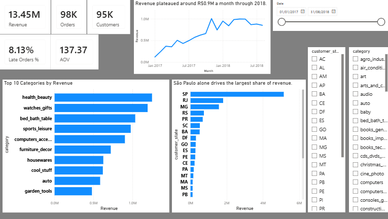
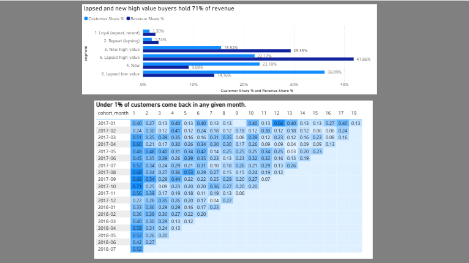
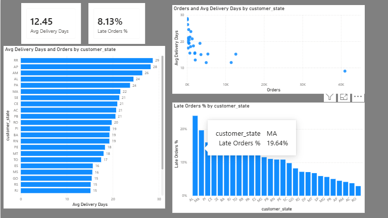

# E-commerce Sales & Customer Analysis (Olist)

**Business question:** Where is this marketplace losing revenue, and which customers are worth retaining?

**Tools:** SQL (SQLite), Excel, Power BI (DAX), Python (data loading)

**Data:** [Olist Brazilian E-Commerce Public Dataset](https://www.kaggle.com/datasets/olistbr/brazilian-ecommerce) (Kaggle), 9 related tables, about 99k orders. Check the dataset page for its license terms.

---

## Key findings

1. **Growth stalled in 2018.** Monthly revenue rose steadily through 2017, peaked around Nov 2017 (likely Black Friday) and then plateaued at roughly R$0.9M a month through Aug 2018.
2. **Almost nobody buys twice.** Only 3.03% of customers placed more than one order. Month-1 retention in every monthly cohort is between about 0.2% and 0.7%, and the curve does not rise over time.
3. **Revenue sits with high-value one-time buyers.** Customers who spent in the top 40% but bought only once make up 37.7% of customers and **71% of revenue**:
   - Lapsed high-value: 20,999 customers (22.2%), 41.9% of revenue (R$5.63M)
   - New high-value: 14,700 customers (15.5%), 29.3% of revenue (R$3.95M)
   - Repeat buyers (loyal + lapsing): 3.0% of customers, 5.6% of revenue
4. **Remote states wait much longer for deliveries.** Average delivery time is about 29 days in Roraima, 28 in Amapá and 26 in Amazonas, versus about 9 days in São Paulo. Overall 8.13% of delivered orders arrive after the estimated date, and the highest late rates are in Alagoas (about 24%) and Maranhão (about 20%). The slowest states are not the ones with the most late orders.

## Recommendations

1. **Win back lapsed high-value customers** (about 21,000 people holding 42% of revenue) with targeted offers.
2. **Prompt a second purchase from recent high-value first-time buyers** (14,700 customers) with a follow-up after delivery.
3. **Treat big acquisition months as a retention problem.** Nov 2017 brought 7,191 new customers, but only 0.56% bought again the next month.
4. **Review delivery promises in states with high late rates** such as Alagoas and Maranhão.

*Illustrative scenario (an assumption, not a forecast):* if 5% of the 35,699 high-value one-time buyers placed a second order at the average spend of about R$268, that would add roughly R$480k.

---

## Dashboard





---

## How I did it

| Step | What | Files |
|---|---|---|
| 1 | Loaded 9 CSVs into SQLite with Python and ran sanity checks | `load_olist.py` |
| 2 | Explored the data: monthly volume, missing values, orders per customer, revenue reconciliation | `sql/01_exploration.sql` |
| 3 | Revenue by month (CTE + `LAG`), top categories (window over aggregate), outlier check | `sql/02_business_queries.sql` |
| 4 | Cohort retention and RFM segmentation | `sql/03_retention_rfm.sql` |
| 5 | Delivery performance by state | `sql/04_delivery.sql` |
| 6 | Combined table for Power BI | `sql/05_fact_orders.sql` |
| 7 | Excel workbook: tables, formula-driven KPIs, pivot tables, charts | `excel/olist_analysis.xlsx` |
| 8 | Power BI dashboard: date table, 9 DAX measures, 3 pages | `powerbi/Olist_Dashboard.pbix` |

### Definitions and decisions
- **Revenue** = `SUM(price)` from `order_items`. Freight is excluded and reported separately. Payments were not joined to items before summing, to avoid double counting.
- **Analysis window:** Jan 2017 to Aug 2018 (20 months). 2016 has almost no orders, and Sep and Oct 2018 are cut off.
- **Excluded orders:** canceled and unavailable orders.
- **Customers** are counted with `customer_unique_id`, because `customer_id` is unique per order.
- **RFM:** recency and spend scored in quintiles (`NTILE(5)`). Frequency was treated as repeat vs one-time, because 97% of customers bought once.
- **Late order:** delivered after the estimated delivery date, among delivered orders with a delivery date.
- **Data checks:** no duplicate orders, no orphaned order items, and Excel KPIs reconciled with SQL totals (revenue about R$13.45M, 94,703 customers, 71% revenue share).

### Limitations
- Revenue, not profit: the data has no cost information.
- Retention is measured only within this marketplace over 20 months, so customers who returned in other ways are invisible.
- "High-value" means the top 40% of customers by spend, a relative threshold.
- State-level averages for small states rest on few orders.

### Data ethics and privacy
- The dataset is anonymized, and no individual customer is identified or profiled.
- Segments are used to guide marketing actions at group level only.

---

## Repository structure
```
olist-project/
  README.md
  load_olist.py
  sql/
  excel/
  powerbi/
  images/
  data/exports/   (small CSV exports)
```
Raw data and `olist.db` are not committed; download the dataset from Kaggle and place the CSVs in `data/raw/`.

## Author
Humair Basheer | [LinkedIn](https://www.linkedin.com/in/humairbasheer/) | [email](humairbashiryousufi@gmail.com)
